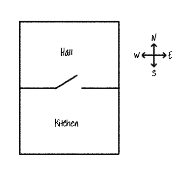
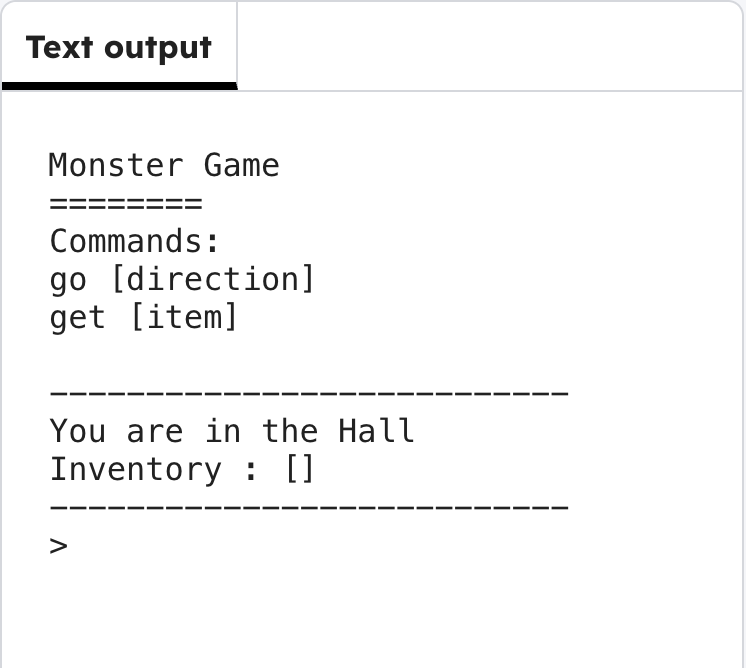

## Go the wrong way

The game is set in a house. Type commands to move around the house.

> [!INFO]
>
> Here's what the house looks like to start with:
>
> 

## Step 1

Click **Run**. The game starts in the **Text output**. Depending on the size of your screen, this is next to your code or below it.



## Step 2

When you see the `>` prompt, type `go west` and press **Enter**. What you type appears in blue under the `>`.

> [!TIP]
>
> If nothing appears when you type, click in the **Text output** and try again.

You can't go west from the hall, so the game reminds you where you are and what's in your inventory:

```
>
go west
You cannot go that way!
---------------------------
You are in the Hall
Inventory : []
---------------------------
>
```

## Step 3

Type `go south` to move to the kitchen, then `go north` to go back to the hall.

## Now run your code

Click **Run** to start a new game. Try a direction that does not work, then move south to the kitchen and north back to the hall.
