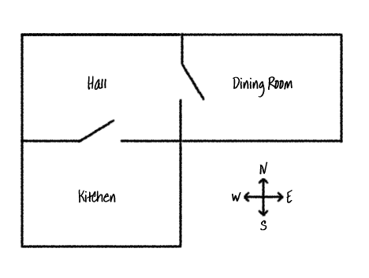

## Add a new room

Add rooms.

Use code to put a dining room east of the hall.

Each room on the map can be coded as a **dictionary**, and rooms are linked together using directions.



> [!INFO]
>
> In this project, you type in two places:
> + **In your code** (`main.py` or `game.py`) to build the game
> + **In the Text output**, after you click **Run**, to play the game

In `main.py`, add the code below to make a new room, and link it to the hall.

```python filename="main.py" line_numbers="true" line_number_start="3" line_highlights="6-7,11-14"
# A dictionary linking a room to other rooms
rooms = {
    'Hall' : {
        'south' : 'Kitchen',
        'east' : 'Dining Room'
    },
    'Kitchen' : {
        'north' : 'Hall'
    },
    'Dining Room' : {
        'west' : 'Hall'
    }
}
```

> [!DEBUG]
>
> + Don't forget to add a comma after 'kitchen' when you add a new direction
> + Make sure you have "closed" the dictionary using curly brackets

## Now run your code

Click **Run**. In the **Text output**, type `go east` and press **Enter** to move from the hall into the dining room. Then type `go west` to go back to the hall.

> [!TIP]
>
> If the button says **Stop** instead of **Run**, your game from the last step is still running. Click **Stop**, then click **Run** to start the game with your new code. It's fine if you see **Execution interrupted** in the **Text output**.
