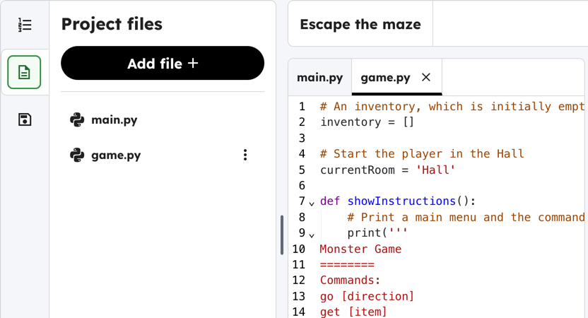

## Winning the game

Make it so the player wins by getting to the garden with the key and the magic potion.

## Step 1

More of the game is in the `game.py`{:.language-python} file. Click the **Project files** icon on the left, then click **game.py**. It opens in a new tab next to **main.py**.

Click the **Project instructions** icon to come back to these instructions. You can switch between `main.py`{:.language-python} and `game.py`{:.language-python} using the tabs above your code.



## Step 2

Add the code below to `game.py`{:.language-python} so that the player wins when they get to the **garden** with the **key** and the **potion**.

```python filename="game.py" line_numbers="true" line_number_start="74" line_highlights="75-77"
        # add more game play here
        if currentRoom == 'Garden' and 'key' in inventory and 'potion' in inventory:
            print('You escaped the house... YOU WIN!')
            break


    return currentRoom, inventory
```

> [!DEBUG]
>
> Make sure the code is indented, in line with the code above it.

## Now run your code

Test your game to make sure the player can win.

```
Monster Game
========
Commands:
go [direction]
get [item]

---------------------------
You are in the Hall
Inventory : []
You see a key
---------------------------
>
get key
You picked up the key
---------------------------
You are in the Hall
Inventory : ['key']
---------------------------
>
go east
---------------------------
You are in the Dining Room
Inventory : ['key']
You see a potion
---------------------------
>
get potion
You picked up the potion
---------------------------
You are in the Dining Room
Inventory : ['key', 'potion']
---------------------------
>
go south
You escaped the house... YOU WIN!
```
